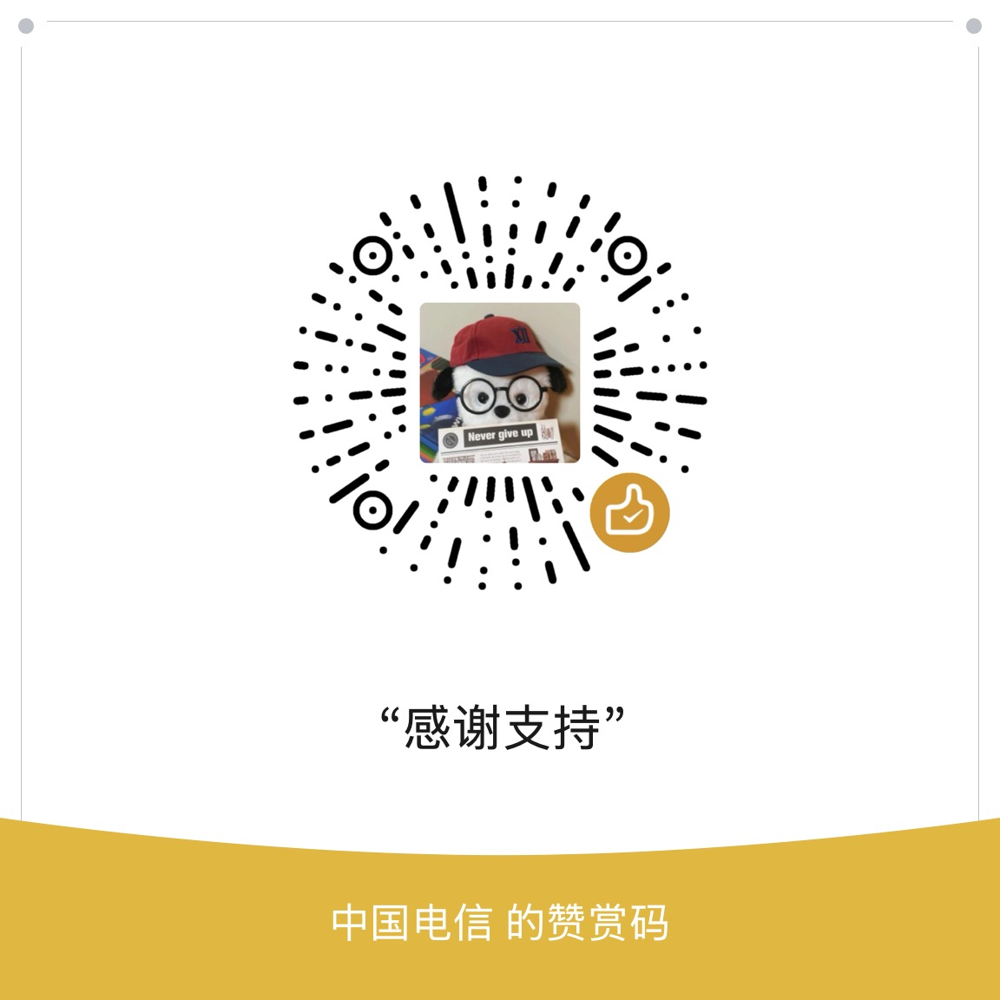

<p align="center">
  
</p>

# Ya-TG

**把光鸭网盘里的影视，自动整理成带海报和简介的 Telegram 帖子，推送到频道 / 群聊。**

Ya-TG 是一个跑在 Docker 里的光鸭网盘资源分发机器人：定时扫描网盘，用 TMDB 识别电影 / 电视剧，自动生成分享链接，再按目录路由推送到 Telegram。全程在中文 Web 后台点选完成，不需要源码、不需要构建、不需要懂 Python。

- 项目地址：https://github.com/Abson2/ya-tg
- 官方镜像：`abson2/ya-tg`（DockerHub 公开可拉取）
- 当前版本：v0.9.16
- 部署：一条 `docker compose up -d`

---

## 开源许可与版权声明

**版权所有 © Abson2。本项目仅供个人学习、研究与非商业用途使用。**

- ✅ 允许：个人自建、学习研究、 Bug 反馈、非商业场景下的修改与自用。
- ❌ 禁止：**任何商业用途**，包括但不限于以本项目直接或变相提供付费服务、二次销售、商业托管、作为商业产品的一部分对外提供。
- 未经作者书面许可，不得用于上述商业目的；因违反本声明产生的法律责任由使用方自行承担。
- 本项目按「现状」提供，不作任何明示或暗示担保；使用者自行评估并承担数据与合规风险。

> 需要商业授权请联系项目作者。保留本声明即视为你已阅读并同意上述条款。

---

## 支持

如果这个项目对你有帮助，欢迎点右上角 Star，也欢迎自愿赞赏，本人花了80大洋购买token，太心痛。



---

## 它能做什么

| 能力 | 说明 |
| --- | --- |
| 光鸭一键授权 | 管理页手机号 + 短信验证码登录，凭证加密保存、自动刷新；内置实现，不依赖第三方项目 |
| A/B 镜像同步 | 源头库只读、镜像库用于分享推送；按「TMDB ID + 类型 + 季 + 集」增量复制、英文改名，只处理新增 / 变化文件 |
| 扫描与识别 | 定时递归扫描入库，TMDB 中文识别（剧名 / 季集 / 标签 / 海报 / 简介），识别存疑转人工，不瞎猜 |
| 自动分享与推送 | 按作品目录建分享链接，推送到 Telegram 频道 / 群聊；有海报发图文，无海报发纯文字；同作品只推一次，失败自动退避重试 |
| 目录路由与白名单 | 按目录 ID 把不同资源路由到不同频道 / 群，推送目标受白名单控制，不私聊刷屏 |
| Bot 用户互动 | 私聊 Bot 求片 / 投稿 / 搜索 / 打赏，TMDB 中文候选点选、会话式交互；后台审核求片投稿 |
| 消息模板 | 多套内置模板 + 自定义，统一配置分享样式、简介篇幅与频道 / 群聊 / 投稿跳转链接 |
| 运维友好 | 中文 Web 后台、链路自检、进度看板、审计日志、失败重试、日志自动清理、指定版本回滚 |

更多细节见 [后台功能使用说明](docs/后台功能使用说明.md)。

---

## 快速开始

### 1. 准备

- 一台装了 Docker 的机器（飞牛 NAS / 群晖 / Linux 均可，能跑 `docker compose`）。
- 一个光鸭网盘账号（部署后在网页里短信登录即可，无需申请开放平台应用、无需抓包）。
- 可选：Telegram Bot（找 @BotFather 创建）和 TMDB API Token（免费申请，用于海报简介）。

### 2. 部署

新建目录并放入两个文件：

```bash
mkdir -p /vol1/1000/docker/ya-tg/db /vol1/1000/docker/ya-tg/logs
cd /vol1/1000/docker/ya-tg
```

**docker-compose.yml**（直接复制，无需修改）：

```yaml
services:
  ya-tg:
    image: abson2/ya-tg:${IMAGE_TAG:-latest}
    container_name: ya-tg
    restart: unless-stopped
    ports:
      - "${WEB_BIND:-0.0.0.0}:${WEB_PORT:-8787}:8787"
    env_file:
      - ./.env
    environment:
      TZ: Asia/Shanghai
      DATABASE_URL: sqlite:////app/db/ya-tg.db
    volumes:
      - ./db:/app/db
      - ./logs:/app/logs
    logging:
      driver: json-file
      options:
        max-size: "10m"
        max-file: "3"
    healthcheck:
      test: ["CMD", "python", "-c", "import urllib.request; urllib.request.urlopen('http://127.0.0.1:8787/api/health')"]
      interval: 30s
      timeout: 5s
      retries: 3
      start_period: 20s
```

**.env**（至少改掉密码和密钥）：

```env
ADMIN_PASSWORD=请改成强密码
APP_SECRET=请改成32位以上随机字符串
WEB_PORT=8787
TMDB_BEARER_TOKEN=
TMDB_LANGUAGE=zh-CN
SCAN_CRON=*/30 * * * *
SCAN_ROOT_ID=
AUTO_CREATE_SHARE=true
SHARE_DURATION=0
```

生成密钥：`openssl rand -hex 32`。执行 `chmod 600 .env` 保护凭证。

### 3. 启动并打开后台

```bash
docker compose up -d
docker compose ps          # 状态为 Up (healthy) 即成功
```

浏览器访问 `http://你的机器IP:8787`，输入 `ADMIN_PASSWORD` 登录。访问不了先检查防火墙是否放行 8787 端口。

### 4. 首次配置（按顺序点）

1. **光鸭授权**：填手机号 → 获取验证码 → 登录并连接。看到「光鸭已连接」即可。
2. **设置扫描范围**：填一个测试目录 ID 先试，点「立即扫描」看资源库有没有文件。
3. **（可选）TMDB 设置**：粘贴 API Read Access Token（`eyJ` 开头）→ 保存并测试。不配也能扫描推送，只是没海报简介。
4. **Telegram**：添加 Bot（填 token）→ 添加频道 / 群（填 `-100...` 形式的 ID）→ 配目录路由 → 先点「测试推送」验证。
5. **正式使用**：测试通过后把扫描目录设为正式范围或留空（全盘），保存后定时任务自动跑。

---

## 常见问题

**Q：容器报光鸭接口 111 / 117？**
111 是出口 IP 未在光鸭开放平台报备（`curl ifconfig.me` 查 IP 去后台加白名单）；117 是 Token 失效，程序会自动刷新，反复失败就重新短信登录一次。

**Q：推送失败、队列里有 error？**
看队列 `error` 列：常见是 Bot token 错、Bot 没在频道里、频道 ID 少写负号、光鸭凭证过期。用「测试推送」逐项定位。

**Q：识别成电影 / 认错剧？**
作品名以父目录为准、剧名优先中文；`S01E04` 等会强制按剧集。仍不准就在资源库点「手动匹配」，凭海报选候选。

**Q：TMDB 报 Invalid API key？**
到「TMDB 设置」重新粘贴 **API Read Access Token**（`eyJ` 开头），系统自动识别 v3 / v4。不影响扫描推送，只是暂时没海报。

**Q：改了 .env 没生效？**
`docker compose up -d --force-recreate` 重建容器。

**Q：数据会丢吗？**
数据库和配置都在 `./db`，不删目录，升级 / 回滚数据都在。建议定期备份。

---

## 文档

- [后台功能使用说明](docs/后台功能使用说明.md)
- [配置说明](docs/配置说明.md)
- [飞牛 NAS 部署与升级](docs/飞牛NAS部署与升级.md)
- [需求追踪矩阵](docs/需求追踪矩阵.md)
- [光鸭接口取证](docs/光鸭接口取证.md)

版本历史与逐版变更见 [CHANGELOG.md](CHANGELOG.md)。

指定版本 / 回滚：在 `.env` 设 `IMAGE_TAG=v0.9.16` 后 `docker compose pull && docker compose up -d`；所有版本见 [Releases](https://github.com/Abson2/ya-tg/releases)。
